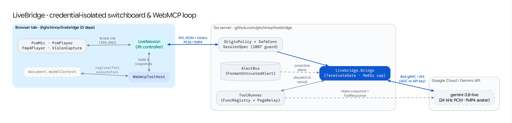
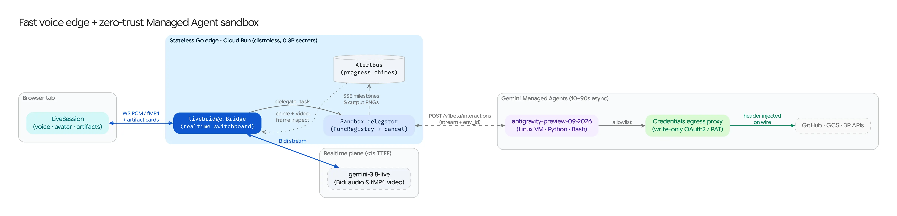

# Developer Guide: Architecture & Implementor Walkthrough

Practical decision guide and architectural explanation for engineers building real-time voice, talking-avatar, tool-using, and proactive applications on **`github.com/ghchinoy/livebridge`** and **`@ghchinoy/livebridge`**.

> **Diátaxis navigation**
>
> - **Tutorial (First 60 Seconds):** [Quickstart](../README.md#quickstart)
> - **Explanation & Decision Guide:** *You are here*
> - **How-To Guides (Copy-Paste Patterns):** [Recipes](recipes.md)
> - **Reference (Framing & Close Codes):** [Wire Protocol & API Reference](wire-protocol.md)

## Contents

- [1. Architecture Decision Matrix](#1-architecture-decision-matrix)
- [2. Step-by-Step Implementor Walkthrough](#2-step-by-step-implementor-walkthrough)
- [3. Seven Gemini Live Sharp Edges Solved Under the Hood](#3-seven-gemini-live-sharp-edges-solved-under-the-hood)
- [4. Testing Your Application Without Spending Quota](#4-testing-your-application-without-spending-quota)
- [5. Deploying to Cloud Run & Reverse Proxies](#5-deploying-to-cloud-run--reverse-proxies)
- [6. Pairing `livebridge` with Gemini Managed Agents](#6-pairing-livebridge-with-gemini-managed-agents)
- [7. Official Gemini 3.8 Live & Reference Resources](#7-official-gemini-38-live--reference-resources)

---

## 1. Architecture Decision Matrix

<picture>
  <source media="(prefers-color-scheme: dark)" srcset="assets/livebridge-architecture-dark.webp">
  
</picture>

Before writing code, pick one option from each of the four axes below. Every combination speaks the exact same WebSocket wire protocol.

### A. Go Backend Entry Point

| Entry Point | When to Choose It | Example |
| :--- | :--- | :--- |
| **`livebridge.NewFixedHandler`** | Your server controls the persona, model, and tools (optionally varied via URL query params in `SpecFromRequest`). Dials Gemini Live immediately on WebSocket upgrade with zero setup frame. | [`01-minimal-voice`](../examples/01-minimal-voice/), [`03-code-assistant`](../examples/03-code-assistant/) |
| **`livebridge.NewDynamicHandler`** | Your UI lets users pick avatars, upload custom `704x1280` / `1280x704` portraits, edit system instructions, or advertise browser WebMCP tools on connect. Reads one `16 MiB` `SessionSpec` JSON frame, enforces server model/location allowlists, tightens the read limit to `8 MiB`, and dials. | [`02-avatar-desk`](../examples/02-avatar-desk/), [`04-ops-watchtower`](../examples/04-ops-watchtower/) |
| **`livebridge.NewBridge`** | You have custom pre-dial authentication, multi-step handshake messages, or custom session lifecycle hooks before handing the upgraded `*SafeConn` and upstream `Session` to the switchboard. | Custom BFF gateways |

### B. Browser Client Packaging

| Entry Point | Toolchain Needed | Best For |
| :--- | :--- | :--- |
| **`github.com/ghchinoy/livebridge/browser`** (`browser.Handler()`) | **None** (`go build` produces a single self-contained binary) | CLI companions, internal tools, Go-embedded HTML apps, portable agent skills (`<script type="module">import { LiveSession } from '/livebridge.js'</script>`). |
| **`@ghchinoy/livebridge`** | Vite / Rollup / esbuild / Webpack (`0` runtime dependencies) | Vanilla TypeScript, React, Vue, or Svelte apps subscribing to `LiveSession` (`EventTarget`) or composing `LiveSocketClient`, `PcmMic`, `PcmPlayer`, `Fmp4Player`, and `VisionCapture` directly. See [`ghchinoy/livebridge-examples`](https://github.com/ghchinoy/livebridge-examples) for complete React 19 (`bilingual-coach`) and Vanilla TS (`whiteboard-architect`) reference apps. |
| **`@ghchinoy/livebridge/lit`** | Vite + `lit ^3.0.0` | Lit 3 Web Component apps using `LiveSessionController` (or granular `ReactiveController`s) to trigger `host.requestUpdate()` automatically. See [`04-ops-watchtower`](../examples/04-ops-watchtower/) and `visual-concierge` in [`ghchinoy/livebridge-examples`](https://github.com/ghchinoy/livebridge-examples). |

### C. Tool Execution Location

| Pattern | How It Works | Best For |
| :--- | :--- | :--- |
| **Server Tools (`FuncRegistry`)** | Go functions run asynchronously off `Session.Receive()` with a per-call `context.Context` that cancels automatically if the user barges in. | Database queries, local filesystem/CLI tools, authenticated internal RPCs, secret-bearing APIs. |
| **Browser / WebMCP Tools (`WebmcpToolHost` + `AllowPageTools: true`)** | Browser advertises JSON Schema tools on connect (and optionally registers them on Chrome's `document.modelContext`). When `SeeVisualResults: true`, any returned `imageDataUrl` (`canvas.toDataURL('image/jpeg')`) is sent upstream as a `{Video}` frame *before* `SendToolResponse`. | Editing an HTML5 `<canvas>`, inspecting DOM state, opening a file picker (`coalesceInFlight: true`), interactive visual workspaces. |

### D. Upstream Authentication (`ClientPool`)

| Credential Source | Audio (`ModeAudio`) | Tools & Search | Talking Video Avatars (`ModeAvatar`) |
| :--- | :-: | :-: | :-: |
| **Google Cloud ADC (`GOOGLE_CLOUD_PROJECT`)** — [Guide](https://docs.cloud.google.com/gemini-enterprise-agent-platform/models/guides/gemini-3-8-live) · [Model Card](https://docs.cloud.google.com/gemini-enterprise-agent-platform/models/gemini/3-8-live) | Yes (`us-central1`) | Yes | **Yes** (`gemini-3.8-live` in `us-central1`; custom avatars require project allowlisting) |
| **Gemini API Key (`GEMINI_API_KEY`)** — [AI Studio Docs](https://aistudio.google.com/docs/models/gemini-3.8-live) | Yes | Yes | No (Google Cloud only) |

---

## 2. Step-by-Step Implementor Walkthrough

### Step 1: Create the HTTP Server & Client Pool

Always construct your `*http.Server` with `livebridge.NewHTTPServer(addr, mux)` rather than `&http.Server{ReadTimeout: ..., WriteTimeout: ...}`: standard HTTP read/write timeouts kill upgraded WebSocket streams mid-conversation, whereas `NewHTTPServer` applies slowloris `ReadHeaderTimeout` (`10s`) and `IdleTimeout` (`120s`) while leaving upgraded streams uncapped.

```go
clients, err := livebridge.NewClientPoolFromEnv()
if err != nil {
  log.Fatal(err)
}
origins := livebridge.NewOriginPolicyFromEnv() // Honors ALLOWED_ORIGINS + loopback dev
mux := http.NewServeMux()
```

### Step 2: Configure `SessionSpec`

`SessionSpec` is the single declarative struct for both static (`NewFixedHandler`) and client-merged (`NewDynamicHandler`) sessions:

```go
spec := livebridge.SessionSpec{
  Mode:                     livebridge.ModeAudio,
  Model:                    livebridge.DefaultModel, // "gemini-3.8-live"
  Location:                 livebridge.DefaultLocation, // "us-central1"
  VoiceName:                "Puck",
  LanguageCode:             "en-US",
  WelcomeMessage:           "Hi! How can I help today?",
  SystemInstruction:        "You are a concise engineering advisor.",
  GroundingContext:         optionalReferenceDocs, // Auto-truncated safely by rune count
  EnableGoogleSearch:       livebridge.Bool(true),
  ProactiveAudio:           livebridge.Bool(true), // Auto-gated off on non-3.8/non-lite models
  ContextWindowCompression: livebridge.Bool(true), // SlidingWindow for long sessions
}
```

### Step 3: Bind the Browser Session (`LiveSession`)

In the browser, `LiveSession` coordinates microphone capture, speaker/video playback, barge-in flushing, page tools, and procedural alert chimes behind a single `EventTarget`:

```ts
import { LiveSession } from '@ghchinoy/livebridge';

const session = new LiveSession({
  mode: 'audio',
  onWarning: (msg) => showBanner(msg), // Surfaces 1007, 1009, 1011, or 10m cap
});

session.addEventListener('change', () => {
  renderTranscript(session.transcript);
  updateControls({
    connected: session.isConnected,
    recording: session.isRecording,
    muted: session.isMuted,
  });
});

await session.connect({ endpoint: '/ws/live' });
```

### Step 4: Upgrade to Talking Video Avatars & Live Vision

To switch from raw 24 kHz PCM audio to a talking video avatar:

1. **Server:** Set `Mode: livebridge.ModeAvatar` and `AvatarData: "Kira"` (or use `NewDynamicHandler` so the client can pass either a preset name or a custom `data:image/jpeg;base64,...` portrait/landscape image).
2. **Browser:** Pass a `<video playsinline autoplay>` element to `session.connect({ mode: 'avatar', endpoint: '/ws', videoElement })`. If accepting user image uploads, run `const cropped = await prepareAvatarImage(fileDataUrl)` first so arbitrary square or phone photos are center-cropped to `704x1280` or `1280x704`.
3. **Live Camera / Screen Vision:** Call `await session.toggleCamera(() => pipVideoEl)` or `await session.toggleScreenShare(() => pipVideoEl)` during an active session to stream 1 FPS JPEG frames upstream alongside smooth native-FPS local preview.

### Step 5: Add Tools or Background Alerts

- **Server Go tools:** Create `reg := livebridge.NewFuncRegistry()`, call `reg.Register(decl, handlerFn)`, and pass `Registry: reg` to `FixedHandlerConfig` or `DynamicHandlerConfig`.
- **Browser WebMCP tools:** Create `const toolHost = new WebmcpToolHost()`, register tools with `await toolHost.register([...])`, pass `toolHost` to `new LiveSession({ toolHost })`, connect with `advertisePageTools: true`, and enable `AllowPageTools: true` (plus `PageToolPolicy{AllowedNames: ...}` and `SeeVisualResults: true`) on `DynamicHandlerConfig`.
- **Background operational alerts:** Create `alerts := livebridge.NewAlertBus(16)`, pass `AlertBus: alerts` + `FormatAlert` (using `livebridge.FormatUntrustedAlert(...)`) to your handler config, and call `alerts.Publish(...)` from any webhook or background goroutine.

---

## 3. Seven Gemini Live Sharp Edges Solved Under the Hood

1. **Deterministic Dual-Socket Teardown (`Bridge.Shutdown`):**
   `google.golang.org/genai`'s `Live.Connect` uses `ctx` only during the dial handshake—canceling `ctx` later leaves the upstream Bidi stream open. `Bridge.Shutdown` (`sync.Once`) cancels timers and in-flight tool contexts, sends an RFC 6455 close frame with a `1s` write deadline (`SafeConn.WriteClose`), and explicitly closes both `upstream` and `ws` on every exit path.
2. **Interrupted Farewell Turn Race (`TerminateGate`):**
   When `session.terminate()` injects a goodbye prompt while the model is mid-sentence, Gemini Live emits `Interrupted`, then `TurnComplete` for the *aborted* turn (~140 ms later), and finally a second `TurnComplete` for the spoken farewell. `TerminateGate` uses atomic state (`terminating` + `pendingInterrupt`) to skip the aborted turn's `TurnComplete` so farewells are never cut off.
3. **Ordered `SetupComplete` Greeting & Alert Gate:**
   `Bridge` waits for upstream `SetupComplete`, injects `GreetingPrompt` first, and only then unblocks `alertLoop` (`setupReady`) so pre-session `AlertBus` backlog items never collide with session setup.
4. **Asymmetric Transcript Accumulation (`TranscriptAssembler`):**
   Gemini Live sends `InputTranscription` partials as *replacement* strings for the current user utterance, whereas `OutputTranscription` partials arrive as *incremental deltas* to append. `TranscriptAssembler` handles both modes immutably and appends ` —` when `interrupted` fires.
5. **fMP4 Codec Sniffing & Inter-Turn PTS Gap Jumping (`SniffMP4` + `Fmp4Player`):**
   Avatar models emit fMP4 fragments only while speaking, creating presentation-timestamp gaps between turns that stall Chrome's MSE demuxer (`BUFFERING_HAVE_NOTHING`). `SniffMP4` parses `ftyp`/`avcC` from the first fragment, and `Fmp4Player` advances `video.currentTime` across inter-turn buffered range gaps on `updateend`, trims buffered future audio/video on barge-in (`flushAndAbort`), and evicts old ranges on `QuotaExceededError`.
6. **Audio-Reactive Mute Graph (`PcmPlayer`):**
   `PcmPlayer` routes `BufferSource -> AnalyserNode -> OutputGainNode -> destination`. Muting sets `OutputGainNode.gain.value = 0` downstream of `AnalyserNode`, so waveform/frequency visualizers stay alive even while speaker audio is muted.
7. **Pre-Dial `1007` Validation (`BuildConnectConfig` + `ParseImageDimensions`):**
   Requesting `[AUDIO, VIDEO]` together, passing a square (`1024x1024`) custom avatar, enabling `ProactiveAudio` on `3.5-flash`, or sending an empty `AutomaticActivityDetection` struct all fail upstream with `1007`. `BuildConnectConfig` enforces every invariant in Go before dialing.

---

## 4. Testing Your Application Without Spending Quota

Because `NewFixedHandler`, `NewDynamicHandler`, and `NewBridge` accept the small `livebridge.Connector` and `livebridge.Session` interfaces, your application's HTTP routes, origin checks, session configs, tools, and alert fan-out can be tested hermetically in milliseconds with `go test -race`:

```go
type fakeSession struct {
  recvCh chan *genai.LiveServerMessage
  done   chan struct{}
}

func (s *fakeSession) SendRealtimeInput(genai.LiveSendRealtimeInputParameters) error { return nil }
func (s *fakeSession) SendToolResponse(genai.LiveSendToolResponseParameters) error   { return nil }
func (s *fakeSession) Receive() (*genai.LiveServerMessage, error) {
  select {
  case m := <-s.recvCh:
    return m, nil
  case <-s.done:
    return nil, io.EOF
  }
}
func (s *fakeSession) Close() error {
  select {
  case <-s.done:
  default:
    close(s.done)
  }
  return nil
}

type fakeConnector struct{ s *fakeSession }

func (c fakeConnector) Connect(context.Context, string, string, *genai.LiveConnectConfig) (livebridge.Session, error) {
  return c.s, nil
}
```

Pass `fakeConnector{s}` into `NewFixedHandler` / `NewDynamicHandler`, wrap it in `httptest.NewServer`, and dial with `websocket.DefaultDialer.Dial(...)`—see [`examples/01-minimal-voice/main_test.go`](../examples/01-minimal-voice/main_test.go) and [`examples/04-ops-watchtower/main_test.go`](../examples/04-ops-watchtower/main_test.go) for complete working examples.

---

## 5. Deploying to Cloud Run & Reverse Proxies

1. **Request timeout (`>= 600s`):** Gemini Live sessions run up to 10 minutes (`9m55s` `DefaultSessionCap`). Set Cloud Run `--timeout=600` (or `900`) so the ingress proxy does not sever active WebSockets at 300 seconds.
2. **Origins (`ALLOWED_ORIGINS`):** Same-origin Cloud Run deployments work with zero configuration. If your frontend is hosted on a separate domain (such as Firebase Hosting), set `ALLOWED_ORIGINS="https://your-frontend.web.app"`.
3. **Multi-instance `AlertBus`:** `AlertBus` fans out across all WebSocket sessions connected to the same Go process. If scaling beyond a single Cloud Run instance and broadcasting webhooks via `AlertBus`, back the webhook publisher with Cloud Pub/Sub or Redis so every instance receives published alerts.

---

## 6. Pairing `livebridge` with Gemini Managed Agents

Google-hosted [Gemini Managed Agents](https://aistudio.google.com/docs/managed-agents-quickstart) sandboxes (`antigravity-preview-09-2026`) run inside isolated Linux VMs with **outbound-only** networking (`POST /v1beta/interactions` SSE data plane and a 15-minute idle auto-stop), so they do not accept inbound browser WebSockets directly.

Instead, pairing **`livebridge` as the thin, stateless Realtime Voice/Avatar Edge** with **Managed Agents as the Zero-Trust Code & Credential Sandbox** gives you sub-second voice/avatar responsiveness *and* isolated autonomous execution:

<picture>
  <source media="(prefers-color-scheme: dark)" srcset="assets/managed-agents-split-dark.webp">
  
</picture>

- **Zero shell or 3rd-party secrets on the `livebridge` server:** Your Go container stays distroless and stateless; GitHub PATs, OAuth2 refresh tokens, and API keys live in Managed Agents' write-only [Credentials API (`/v1beta/credentials`)](https://aistudio.google.com/docs/agent-credentials) and are injected on the wire by Google's egress proxy.
- **Async SSE progress via `AlertBus`:** Long-running sandbox tasks (`10–90s`) stream `InteractionSSEStreamEvent`s in a background goroutine, publishing milestone summaries to `AlertBus` (`ChimeSynth` + spoken updates) and downloading generated charts from `/v1beta/environments/{id}/files/...` for UI display and `SendRealtime({Video})` visual inspection. See `samples/antigravity-voice-desk` in [`ghchinoy/livebridge-examples`](https://github.com/ghchinoy/livebridge-examples).

---

## 7. Official Gemini 3.8 Live & Reference Resources

- **[Gemini 3.8 Live Developer Guide (Google Cloud)](https://docs.cloud.google.com/gemini-enterprise-agent-platform/models/guides/gemini-3-8-live)** — Authoritative guide to Bidi streaming, talking video avatars, custom avatar image requirements, replicated voice, and proactive audio.
- **[Gemini 3.8 Live Model Card (Google Cloud)](https://docs.cloud.google.com/gemini-enterprise-agent-platform/models/gemini/3-8-live)** — Endpoint regions, supported input/output modalities, and session caps.
- **[Gemini 3.8 Live on Google AI Studio](https://aistudio.google.com/docs/models/gemini-3.8-live)** — Using `gemini-3.8-live` with a Gemini Developer API key (`GEMINI_API_KEY`).
- **[Gemini Live Studio (`GoogleCloudPlatform/generative-ai`)](https://github.com/GoogleCloudPlatform/generative-ai/tree/main/gemini/multimodal-live-api/gemini-live-studio)** — Full-featured reference application showcasing `livebridge`'s switchboard and browser media architecture at scale.
- **[`ghchinoy/livebridge-examples`](https://github.com/ghchinoy/livebridge-examples)** — External multi-framework showcase apps (Lit 3, Vanilla TS, React 19, and Zero-Node Go).
